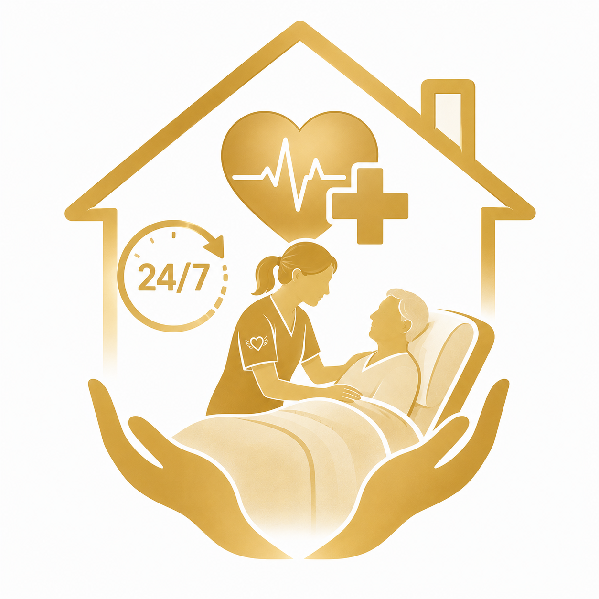
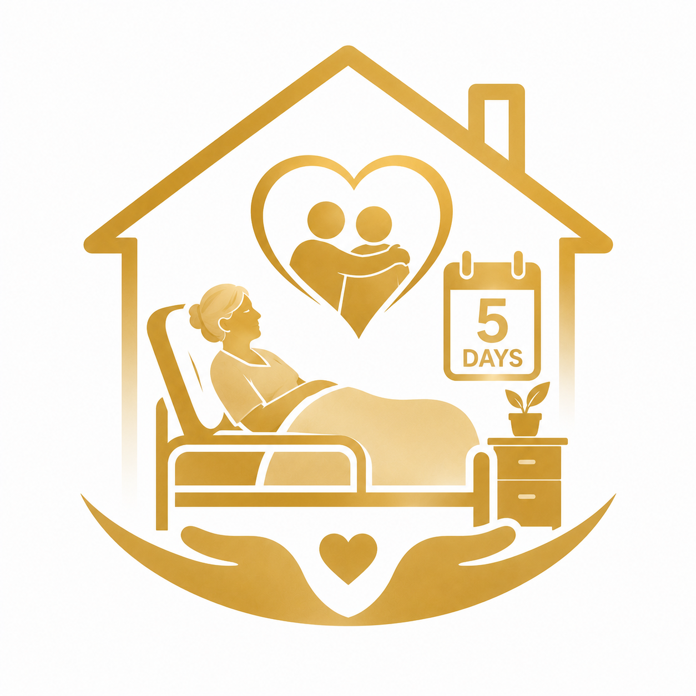
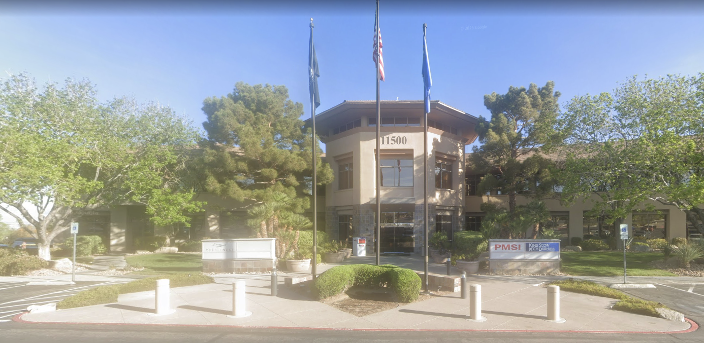

#   Haloes Touch Hospice Inc.
### Website Overview & Walkthrough

Compassion and care that feels like family.

**haloestouch.com** · 702-625-4644

---

## Agenda

1. About the Project
2. Who We Serve — Our Mission
3. Services Offered
4. Levels of Hospice Care
5. Why Families Choose Us
6. Medicare Coverage
7. Patient & Family Reviews
8. Design System (Dark / Light Theme)
9. Tech Stack
10. Contact & Next Steps

---

## About the Project

- Marketing website for **Haloes Touch Hospice Inc.**, serving Las Vegas & Henderson, NV
- Built as a fast, accessible, single-page React site
- Sections: Home, About Us, Services, Why Choose Us, Reviews, FAQ, Medicare, Contact, Legal
- Mobile-first, fully responsive, accredited (ACHC) branding throughout

---

## Our Mission

 

> *"Comfort, dignity, and compassionate care when it matters most."*

Our mission is to provide compassionate, patient-centered hospice care that promotes comfort, dignity, and quality of life for individuals facing life-limiting illnesses — through an interdisciplinary team supporting physical, emotional, psychosocial, and spiritual needs.

---

## Services Offered

- Hospice Physician Services
- Skilled Nursing Care
- Medical Equipment & Supplies
- Hospice Aide Services
- Social Work Support
- Spiritual Care
- Bereavement Support (up to 1 year)
- Volunteer Support

---

## Levels of Hospice Care

| Routine Home Care | Continuous Home Care |
|---|---|
|  |  |

| Respite Care | General Inpatient Care |
|---|---|
|  |  |

---

## Why Families Choose Us

- Trained and fully licensed clinical staff
- Personalized care plans (COPD, CHF, diabetes, fall prevention)
- Available **24/7, 365 days a year**
- Medicare-certified — full coverage for eligible patients
- Trusted name in Southern Nevada hospice care
- Quality scores that exceed national benchmarks

---

## Comfort & Therapy Options

- Music therapy
- Art therapy
- Aromatherapy
- Animal therapy
- Memory making
- Calming touch
- Meditation & mindfulness

**ACHC Accredited**

---

## Medicare Coverage — Eligibility

1. **Medicare Part A** — entitled & using a Medicare-certified hospice
2. **A Terminal Illness** — certified by hospice & attending physician
3. **Prognosis of Six Months or Less** — recertification allows continued care
4. **A Choice to Focus on Comfort** — electing the Hospice Benefit over curative treatment

---

## What Families Say

> *"...everyone treated my mom with dignity and respect... the support from Haloes Touch did not simply end... their bereavement program continued to provide comfort."*
> — **Watana H.**, daughter of patient

> *"Phil was incredibly helpful throughout the entire process... The placement he found for my dad has exceeded our expectations."*
> — **Shep A.**, family member

⭐ Verified on Google Reviews

---

## Design System — Dark & Light Theme

- Brand palette: deep forest green, moss, brand gold, warm cream
- **New:** Sun/Moon toggle in the header lets visitors switch between:
  - 🌙 **Dark** (default/original look)
  - ☀️ **Light / White** theme
- Preference saved via `localStorage`, no flash on reload
- All cards, buttons, badges, and accessibility contrast verified in both modes

---

## Tech Stack

- **React 18** + **Vite 5** — fast dev/build pipeline
- **React Router 7** — client-side routing (Privacy, Terms, Accessibility, etc.)
- **Tailwind CSS** + custom CSS design tokens
- **Lucide React** — icon set
- **Web3Forms** — contact form submissions
- **React Hot Toast** — UI notifications
- Deployed as a static site (Netlify-style `_redirects` included)

---

## Accessibility & Compliance

- Skip-to-content link, visible focus states
- Dedicated **Accessibility**, **Privacy Policy**, **Terms of Use** pages
- **Notice of Privacy Practices** page (HIPAA-aligned)
- AI Image Notice disclosure page
- Semantic headings & ARIA labels throughout

---

## Contact & Next Steps

**Haloes Touch Hospice Inc.**
11500 S Eastern Ave, Ste 150
Henderson, NV 89052

📞 702-625-4644
📠 702-960-4065
✉️ services@haloestouch.com

---

# Thank You

### Questions & Feedback Welcome

